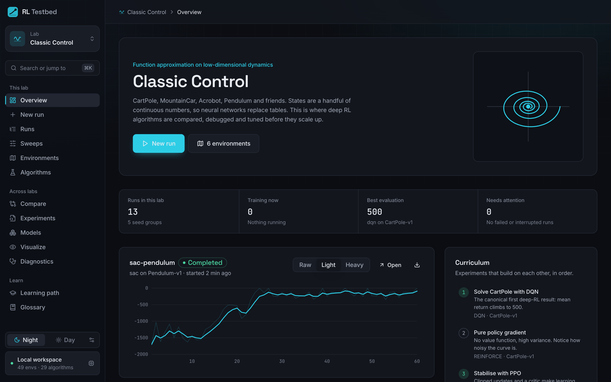
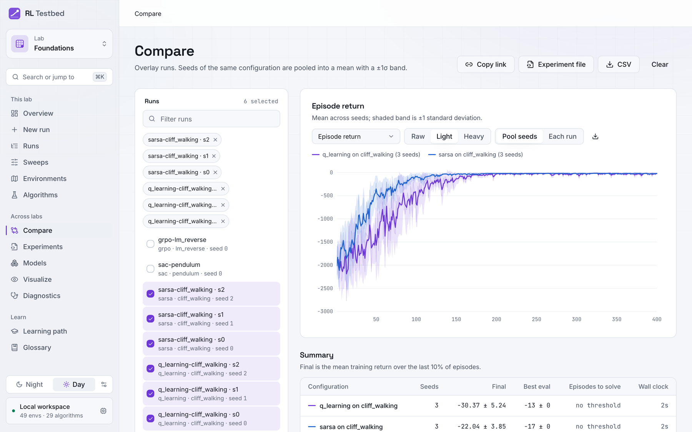
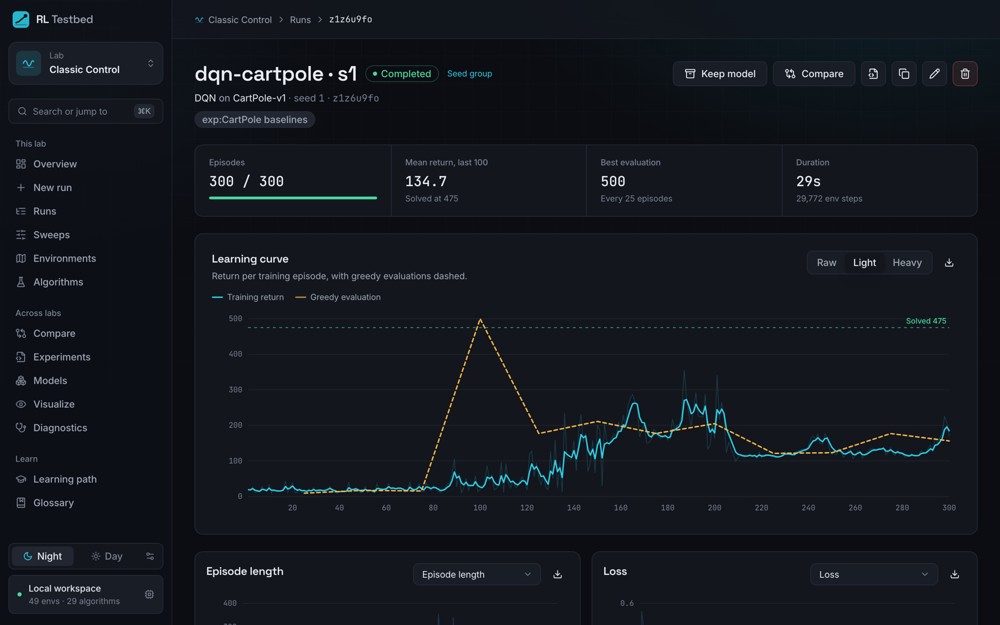
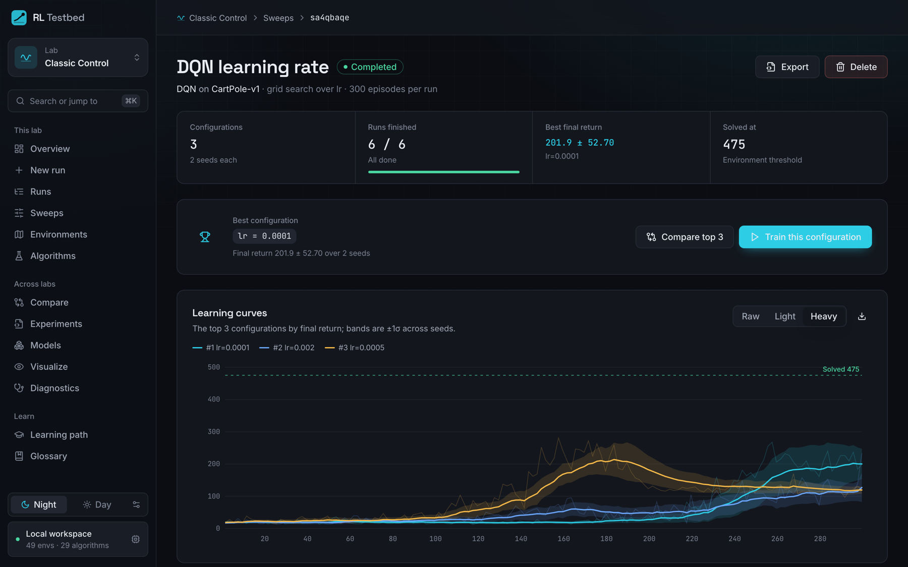
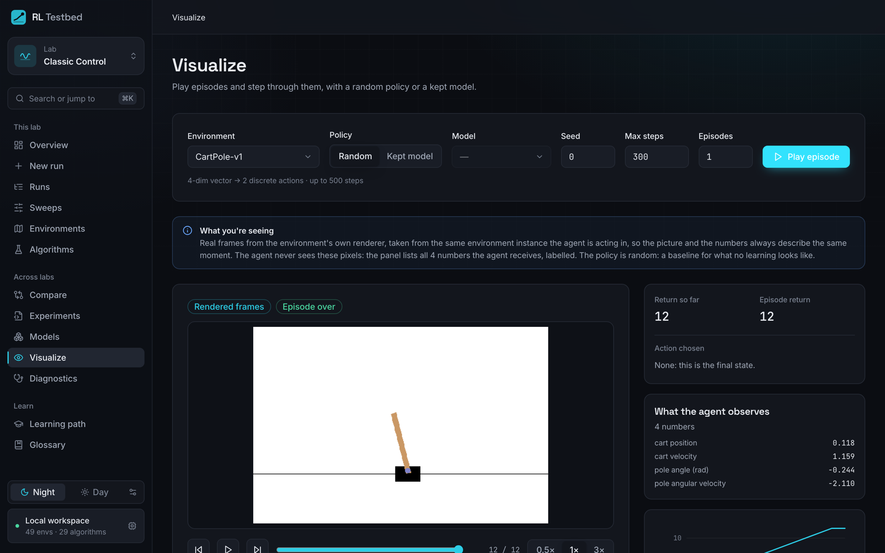
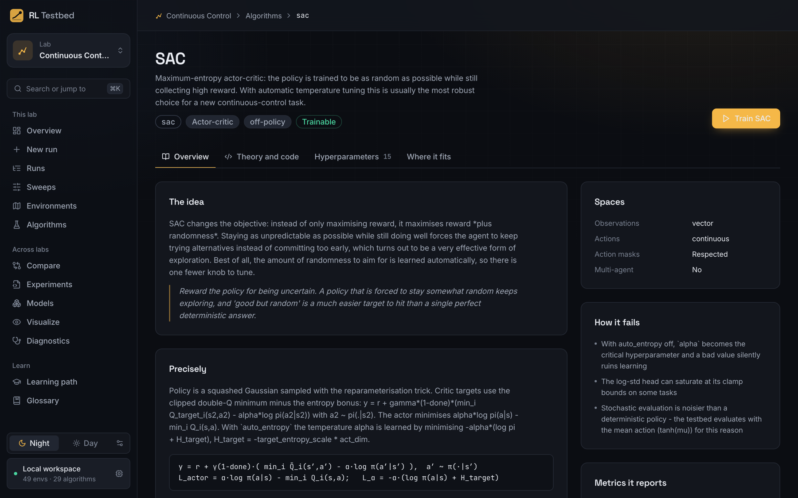
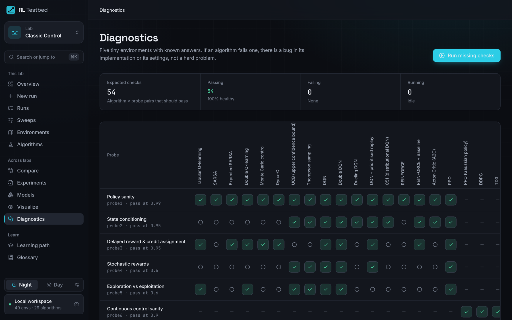
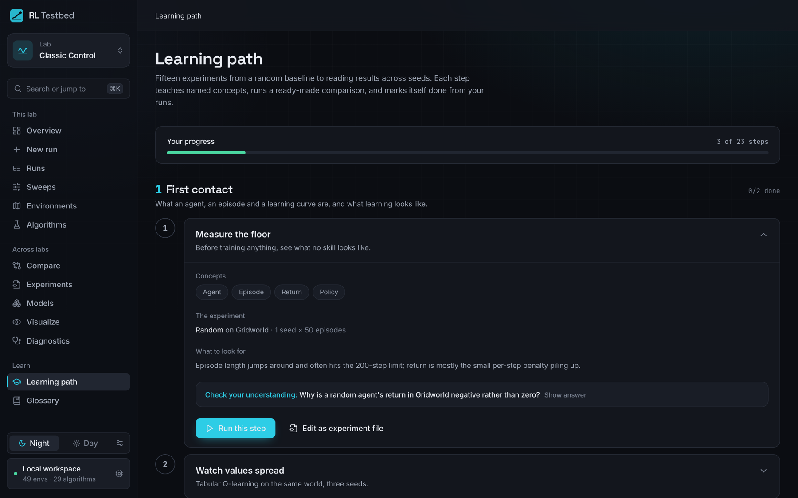
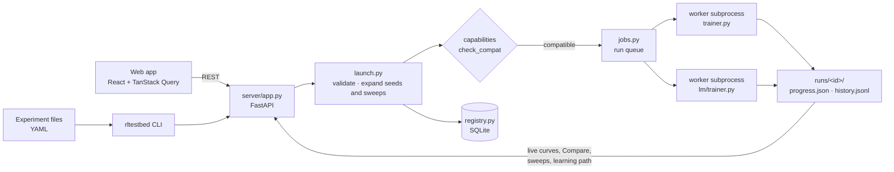

# RL Testbed

**A local laboratory for learning and doing reinforcement learning.**
Pick an environment and an algorithm, launch a run, watch it learn live, compare
methods across seeds, and read the theory behind every one of them, in one web
app with a matching command line.



Every algorithm is implemented in this repository, readably, from tabular
Q-learning to SAC, PETS world models and GRPO for language models, so you can
study the code as well as run it.

## What you can do

- **Train and watch.** 29 algorithms on 43 environments, each run in its own
  process with a live learning curve, greedy evaluations and per-algorithm metrics.
- **Compare honestly.** Run several seeds and see the mean with a ±1σ band;
  sweep hyperparameters and see each one's effect.
- **See what the agent sees.** Step through episodes frame by frame, with the
  observation labelled and the chosen action named. World models show their
  imagined trajectory against the real one.
- **Learn.** A 23-step learning path from a random baseline to RL for language
  models; each step runs a real comparison and marks itself done from your runs.
  An 85-term glossary with formulas, and theory pages for every algorithm.
- **Reproduce.** Describe runs and sweeps in YAML experiment files, commit them
  with your code, and rerun them anywhere.

## A tour

All screenshots come from a fresh install after running
[`experiments/cartpole-baselines.yaml`](experiments/cartpole-baselines.yaml), a
Cliff Walking comparison and the diagnostic probes.

### Compare across seeds



Seeds of one configuration pool into a mean with a ±1σ band, and the summary table
reports final return, best evaluation and episodes-to-solve. Here is the textbook
Cliff Walking result reproduced over three seeds: Q-learning learns the optimal
path along the cliff edge (greedy evaluation −13) but its exploratory training
return is worse (−30), because ε-greedy steps fall off the cliff; SARSA learns the
safer path (−17) and trains better (−22).

<table>
  <tr>
    <td width="50%" valign="top">
      
      <p><b>Run detail.</b> Training return per episode with greedy evaluations
      dashed, the solve threshold, and every metric the algorithm reports.</p>
    </td>
    <td width="50%" valign="top">
      
      <p><b>Sweeps.</b> Grid or random search over hyperparameters, each
      configuration run on several seeds; the best one is one click from a new run.</p>
    </td>
  </tr>
  <tr>
    <td width="50%" valign="top">
      
      <p><b>Visualize.</b> Step through an episode frame by frame. The panel lists
      exactly the numbers the agent observes, labelled, and the action it chose.</p>
    </td>
    <td width="50%" valign="top">
      
      <p><b>Algorithm pages.</b> The idea in plain words, the exact update rule,
      how it fails, its hyperparameters and where it fits among the others.</p>
    </td>
  </tr>
  <tr>
    <td width="50%" valign="top">
      
      <p><b>Diagnostics.</b> Six probe environments with known answers. Each
      algorithm is checked on the probes it should pass; a failure means a bug, not
      a hard problem.</p>
    </td>
    <td width="50%" valign="top">
      
      <p><b>Learning path.</b> 23 steps, each with concepts, a ready-made experiment,
      what to look for and a check-your-understanding question.</p>
    </td>
  </tr>
</table>

## Labs

| Lab | What it studies | Examples |
| --- | --- | --- |
| Foundations | Tabular methods, bandits, exploration | Gridworld, Dyna Maze, CliffWalking, 10-armed bandit |
| Classic Control | Function approximation on small dynamics | CartPole, MountainCar, Acrobot, Pendulum |
| Continuous Control | Torque control of simulated bodies | 11 MuJoCo tasks, BipedalWalker |
| Perception | Acting from pixels | 5 MinAtar games |
| Multi-Agent | Two-player games | Tic-Tac-Toe, Connect Four, Texas Hold'em |
| Language models | RL fine-tuning of a tiny transformer | Verifiable-reward tasks, reward hacking |

Algorithms include Q-learning, SARSA, Dyna-Q, UCB, Thompson sampling, DQN (double,
dueling, prioritised, C51), REINFORCE, A2C, PPO, DDPG, TD3, SAC, CrossQ, PETS,
Dreamer-lite, GRPO (with Dr. GRPO and DAPO variants) and DPO. A diagnostics page
runs six probe environments with known answers against every algorithm.

## How it works

Three front doors, one launch path. The web app, experiment files and the CLI all
create runs through `launch.py`; every run trains in its own subprocess, so a crash
never takes the server down.



Each worker steps one agent through one environment. Agents and environments
declare their observation and action types; compatibility is decided in one
place, never special-cased.

```mermaid
flowchart LR
    E["Environment<br/>reset() · step()"] -->|"obs, reward,<br/>terminated, truncated"| T["Trainer loop"]
    T -->|obs| A["Agent<br/>get_action()"]
    A -->|action| E
    T -->|transition| U["Agent<br/>update()"]
    U -->|get_metrics()| T
    T -->|every N episodes| EV["Greedy evaluation"]
    T --> H["history.jsonl"]
    EV --> H
```

## Quick start

Requires **Python 3.11** and **Node.js 20 or newer**.

```bash
git clone https://github.com/SauravBastola/rl-testbed.git
cd rl-testbed

python3.11 -m venv .venv && source .venv/bin/activate
pip install -r requirements.txt
pip install -e . --no-deps            # installs the `rltestbed` command

cd web && npm install && npm run build && cd ..

rltestbed serve --port 8000           # open http://localhost:8000
```

Optional extras unlock more environments; the app works without them:

```bash
pip install "gymnasium[mujoco]"       # Continuous Control lab
pip install "gymnasium[box2d]"        # LunarLander, BipedalWalker
pip install rlcard                    # Texas Hold'em
```

From the terminal:

```bash
rltestbed train dqn cartpole --episodes 300
rltestbed run experiments/cartpole-baselines.yaml --dry-run
rltestbed export <run or sweep id> -o my-experiment.yaml
```

## Documentation

| | |
| --- | --- |
| [docs/CONTEXT.md](docs/CONTEXT.md) | Architecture, invariants and lessons learned: start here to contribute |
| [docs/ALGORITHMS.md](docs/ALGORITHMS.md) | Every algorithm, with its theory |
| [docs/ENVIRONMENTS.md](docs/ENVIRONMENTS.md) | Every environment |
| [docs/RESEARCH.md](docs/RESEARCH.md) | Recent research and how it is reflected here, with sources |
| [docs/DECISIONS.md](docs/DECISIONS.md) | Design decisions and why |
| [docs/ROADMAP.md](docs/ROADMAP.md) | What is planned next |
| [docs/MUJOCO.md](docs/MUJOCO.md) | MuJoCo setup notes |

## Development

```bash
pip install -r requirements-dev.txt
make check          # lint, contrast checks, 145 backend + 50 frontend tests, build
cd web && npm run dev   # live-reloading UI on :5173 (run `rltestbed serve` alongside)
```

See [CONTRIBUTING.md](CONTRIBUTING.md) for the workflow.

## Security

RL Testbed is a single-user tool with **no authentication**. It listens on
`127.0.0.1`, accepts only `localhost` host names (blocking DNS rebinding) and
grants no cross-origin access, so other websites cannot call it. Do not expose it
to a network you do not trust: anyone who can reach the port can start and delete
runs. Details in [docs/DECISIONS.md](docs/DECISIONS.md).

## Status

Actively developed; see the roadmap. Language models here are ~100k-parameter
character transformers: the algorithms are the real ones, the scale is not.

## License

[MIT](LICENSE) © Saurav Bastola
